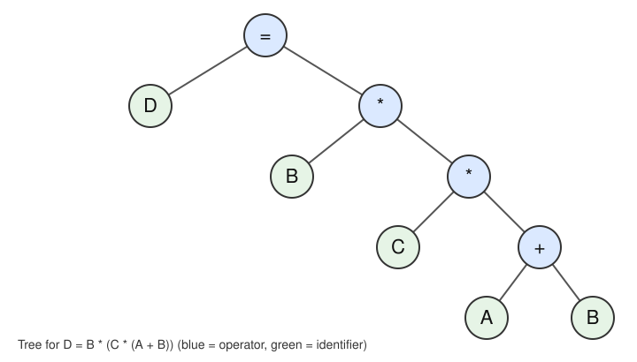

# Intermediate Code Generator

A small compiler front end in C++. It reads simple C-style declarations and assignments (`int`, `float`, `+ - * /`, parentheses) and prints stack-machine style intermediate code, followed by a symbol table.

## Where this came from

I started with the lexical analyzer from *Concepts of Programming Languages* (12th edition) by Robert W. Sebesta. The BNF/EBNF grammar definitions and the compiler theory behind this came from lectures by Dr. John Svadlenka in Principles of Programming Languages at Queens College (Fall 2025). Everything else was built or modified by me, including the parser, the syntax tree, type checking, the symbol table, and the code generation.

## What's included

* Lexical Analyzer
* Syntax Analyzer
* Syntax Tree Construction
* Semantic Analyzer
* Intermediate-ByteCode Generator

## How it works

1. The lexer breaks the input into tokens.
2. A recursive-descent parser builds a syntax tree using this grammar:
   ```
   <assign> -> <ident> = <expr>
   <expr>   -> <term> {(+ | -) <term>}
   <term>   -> <factor> {(* | /) <factor>}
   <factor> -> ident | int_constant | float_const | (<expr>)
   ```
3. The tree is type-checked (`int` / `float`).
4. The tree is walked in postorder to print the intermediate code.

# About the memory addresses

The addresses in the intermediate code and the symbol table are real, dynamically allocated memory addresses, not made-up numbers. Each variable's value is stored at the address shown, so the symbol table entries are backed by actual memory. They change every run because the system picks where to allocate them.

## Build and run

```
g++ src/intermediate_code_generator.cpp -o icg
cp examples/sample_input.txt input.txt
./icg
```

It reads `input.txt` and writes `output.txt`.

## Example

Input:
```
int A = 10, B = 20, C = 30
int D
D = B * (C * (A + B))
```

Syntax tree for the last line:



Output:
```
================================================
push addr(A)(0x557a61d86350)
push 10
assign

push addr(B)(0x557a61d86430)
push 20
assign

push addr(C)(0x557a61d86490)
push 30
assign

push addr(D)(0x557a61d864f0)
push B(20)
push C(30)
push A(10)
push B(20)
iadd
imult
imult
assign


Symbol Table has 6 entries.

Entry name: int
Is Identifier: False
Type: KEYWORD
lvalue: NULL
rvalue: NULL

Entry name: float
Is Identifier: False
Type: KEYWORD
lvalue: NULL
rvalue: NULL

Entry name: A
Is Identifier: True
Type: INT
lvalue: 0x557a61d86350
rvalue: 10

Entry name: B
Is Identifier: True
Type: INT
lvalue: 0x557a61d86430
rvalue: 20

Entry name: C
Is Identifier: True
Type: INT
lvalue: 0x557a61d86490
rvalue: 30

Entry name: D
Is Identifier: True
Type: INT
lvalue: 0x557a61d864f0
rvalue: 18000

================================================
```